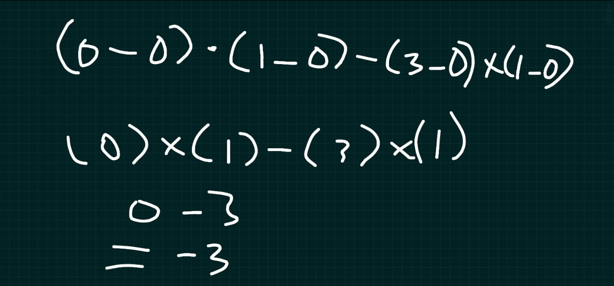

To you all who feel that maths is meaningless, here's a simple yet complicated algorithm that's behind most of the visuals you see on your screens, be it your phone, PC, television, smartwatch, or even a smart fridge 😅

Early computer scientists faced a problem when it came to rendering arbitrary shapes on computer screens. Using seven-segment displays to render numbers didn't quite cut it, so they needed a way to draw objects on more sophisticated 2D screens made up of pixels.

While exploring possible solutions, they started by focusing on rendering simpler shapes before tackling more complicated ones. During this period, a bunch of algorithms for drawing points and lines were invented, like the infamous Bresenham's line algorithm.

While these algorithms did well in their own right, they didn't quite solve the problem of efficiently drawing arbitrary filled shapes. Take a square, for example. To draw its outline using a line algorithm, you'd have to draw four separate lines. But to fill its interior, you need another method: something that determines which pixels lie inside the square and which ones lie outside it.

One approach is to scan through the square's area, drawing horizontal lines from left to right and top to bottom. This works, but deciding which pixels to fill, handling the boundaries, and avoiding gaps or inconsistencies can get complicated. Early display technologies and rendering techniques had their own limitations, but the progress made at the time was still a huge leap forward in displaying visuals.

There were, however, many things that could be improved, and that brings me to triangles.

Triangles have many properties that make them one of the best primitives for rendering arbitrary shapes. Almost any shape can be approximated using a combination of triangles. The perspective projection of a triangle is still a triangle, provided we're talking about an ordinary projection without clipping complications. Its surface remains flat, and it's relatively easy to interpolate values across it, making it an excellent candidate for rasterization.

This simplified the problem a lot, taking it from "How do we render arbitrary shapes?" to "How do we efficiently render a simple triangle?"

A researcher named Juan Pineda explored this problem and came up with an algorithm based on some very simple mathematical operations that we should already be familiar with. This is why I'm writing this long-ass message that you all probably won't even read because of your fucked attention span 😂💔

Breaking down the problem even further, let's ask a simple question:

Given a single line AB with a specified direction, how can we determine whether a point P lies to the left or right of that line?

I urge each and every one of you who managed to read up to this point to ponder this problem a little bit. With the illustration I've badly drawn in the image underneath this text, try to come up with a solution. I myself wasn't able to come up with one, but you all are way smarter than me, so it should be possible for you to find a solution that works 🫠

---

Exploring Pineda's solution to this problem, let's define our variables a bit.

A line has a starting point and an endpoint, A and B, respectively, on a 2D plane. P is simply another point on that plane.

Let's take some simple values. Suppose the line starts at the origin of our coordinate system, , and points straight up to . Now, suppose point P is at .

If we draw this out, we can see that P is to the right of the line, assuming we're looking at the coordinate system with the positive X-axis pointing right and the positive Y-axis pointing up.

But how can we determine that mathematically, or even through code, without having to draw anything?

Before we solve that, I should explain why determining which side of a line a point lies on helps us draw a triangle.

A triangle is made up of three vertices connected by three edges. If we order the vertices counterclockwise, every point strictly inside the triangle lies to the left of each directed edge, assuming the edges are directed along the triangle's boundary in that same counterclockwise order.

Think about it: if we know how to determine whether a point is to the left or right of a line, we can use that information to determine whether a point lies inside a triangle.

For each of the triangle's three edges, we check which side of the edge the point lies on. If the point lies on the correct side of all three edges, it's inside the triangle. If it lies outside any one of them, it's outside the triangle. Points that lie exactly on an edge require a consistent boundary rule, but we'll leave that detail for later.

Back to solving the problem.

Given points A, B, and P, we can determine whether P is to the left, right, or directly on the line AB using something called the edge function.

The edge function, , is defined as:

```
E(A,B,P) = (B.x - A.x)*(P.y - A.y) - (B.y - A.y) * (P.x - A.x)
```

Don't let the equation scare you. It's just multiplication and subtraction. Nothing too crazy.

The edge function returns:

- A value > 0 if P is to the left of the directed line AB.
- A value < 0 if P is to the right of the directed line AB.
- 0 if P lies directly on the line AB.

The sign convention assumes the usual Cartesian coordinate system, where positive X points right and positive Y points up.

Now, let's solve our example using the values we defined earlier:

```
A = (0,0), B = (0,3), and P = (1,1)
```

First, let's substitute the values into our edge function:

```
E(A,B,P) = (B.x - A.x)*(P.y - A.y) - (B.y - A.y) * (P.x - A.x)
```

> Will be done in another image 🥲



Since the result is less than zero, P lies to the right of the directed line AB.

And there you have it! We just determined which side of a line a point lies on using nothing more than multiplication and subtraction.

Now imagine doing this for every edge of a triangle and checking thousands or millions of points across a screen. That's the fundamental idea behind the edge-function approach to triangle rasterization.

Pineda's algorithm takes advantage of the fact that the edge function can be evaluated efficiently across a grid of pixels, allowing a renderer to determine which pixels are covered by a triangle without having to draw every edge individually.

That's one of the fundamental ideas behind how your GPU turns triangles into the pixels you see on your screen.

With this, I hope y'all will find it within you to appreciate mathematics a bit. It's quite a fascinating subject.

---

To answer the questions y'all probably won't ask,

1. Yes, I'm doing it for fun
2. Yes, no matter how much slander I get for posting ts I will still type out a long ass message if I find a fascinating topic
3. Yes, I'm single 😅
4. Dankenny, it's not ai
5. If u have questions, ask

Also, if you find the need to explore this topic more I have the original paper by Pineda on the topic and I should still have the tabs for the blog posts I read so I can send the link

[C++ Software Rasterizer](https://github.com/magnums123/Software-Rasterizer.git) a badly written implementation of the algorithm by yours truly

> I don't know if it works, was experimenting

I'll rewrite in python when I get the chance and finally get around to learning the language

Much hate ✌️ Just a Boy 🌚
Sorry, Love
